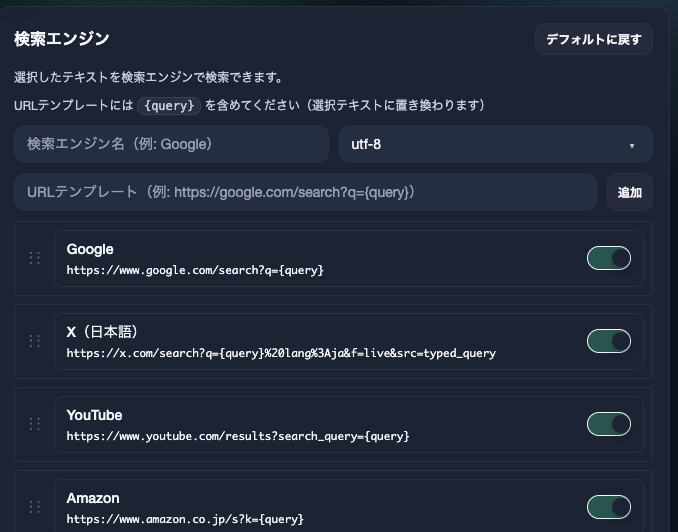

# Browser Toolkit

個人用の Chrome 拡張機能（Manifest V3）です。テーブルソート、AI による要約・翻訳・コードレビューなど、日々のブラウザ作業で欲しい機能をまとめています。

主な機能:

- テーブルをクリックでソート（動的に追加されるテーブルにも対応）
- AI（OpenAI / ChatGPT プラン / Anthropic / z.ai）を使った「Context Actions」（要約・翻訳・コードレビューなど）をポップアップや右クリックメニューから実行
- カレンダー登録（ページ内容からイベント情報を抽出し、Google カレンダーや iCal に登録）
- リンク作成（タブのタイトルと URL を複数の形式でコピー）
- 検索エンジン（選択テキストをカスタム検索エンジンで検索）/ まとめて検索（グループ単位で一括検索）
- テキストテンプレート（定型文を右クリックメニューから貼り付け）
- QR コード生成（現在のページ URL をページ上にオーバーレイ表示）
- アクション履歴（直近の AI 実行結果を参照）
- 検索結果ブロックリスト（Google の検索結果から指定サイトを非表示）

## スクリーンショット

### Context Actions（要約）


記事やページ本文を選択して「要約」を実行すると、AI が内容を要約してオーバーレイ表示します。結果はコピーしたり、画面上に固定したりできます。

### カレンダー登録


イベントページで実行すると、タイトル・日時・場所・概要を自動で抽出し、Google カレンダーや iCal に登録できます。

### 検索エンジン



選択したテキストをカスタム検索エンジンで検索できます。URL テンプレートに `{query}` を含めることで、任意の検索先を追加できます。

### まとめて検索


複数の検索エンジンをグループ化して、一度にまとめて検索できます。たとえば「お買い物」グループを作っておけば、Amazon、楽天、ビックカメラ、ヨドバシを一括で検索できます。

## 機能一覧

### テーブルソート

- `<th>` ヘッダーのクリックでソート（昇順・降順を切り替え）
- 数値と文字列を自動判定
- 自動有効化:
  - すべてのサイトで有効化
  - URL パターンに一致するサイトのみで有効化（`*` ワイルドカード対応、プロトコルは無視）
- `MutationObserver` により、後から動的に挿入されたテーブルも自動検出
- 行フィルタリング: 0円・ハイフン・空白・N/A の行を非表示（パターンごとに ON/OFF 切り替え）

### Context Actions（AI 連携）

- 対応プロバイダー:
  - OpenAI（GPT-5 系列ほか）
  - ChatGPT プラン（Sign in with ChatGPT。Plus / Pro の利用枠を使うため API キー不要）
  - Anthropic（Claude Sonnet 4.5 ほか）
  - z.ai（GLM-4.7 ほか）
- 実行方法:
  - ポップアップ → **アクション** タブ
  - 右クリック → **Browser Toolkit** → アクション
- 組み込みアクション:
  - 要約（日本語）
  - 日本語に翻訳
  - コードレビュー
- カスタムアクション:
  - ポップアップから作成・編集・削除・リセットが可能
  - テンプレート変数: `{{text}}` / `{{title}}` / `{{url}}` / `{{source}}`
- ドラッグ&ドロップで並び替え可能（右クリックメニューの順序にも反映）
- 結果表示:
  - ポップアップ内の出力パネル（コピー機能付き）
  - 右クリック実行時はページ上にオーバーレイ表示（コピー・固定・ドラッグ移動に対応）

詳細は `docs/context-actions.md` を参照してください。

### カレンダー登録

- ページの本文や選択テキストから、イベントのタイトル・日時・場所・概要を AI が抽出
- 抽出結果を Google カレンダーの登録 URL、または `.ics`（iCal）ファイルとして出力
- ポップアップ → **カレンダー登録** タブ、または右クリックメニューから実行

### QR コード生成

- 右クリック → **Browser Toolkit** → **QR コードを表示** で、現在のページ URL を QR コード化
- ページ上にオーバーレイ表示

### リンク作成

- 現在のタブのタイトルと URL を、複数の形式でクリップボードにコピー
- 対応形式:
  - URL
  - テキスト（タイトル + 改行 + URL）
  - Markdown: `[タイトル](URL)`
  - HTML: `<a href="URL">タイトル</a>`
  - Org-mode: `[[URL][タイトル]]`
  - BBCode: `[url=URL]タイトル[/url]`
- 右クリック → **Browser Toolkit** → **タイトルとリンクをコピー** からも実行可能

### 検索エンジン

- 選択テキストを任意の検索エンジンで検索
- 既定の登録先: Google、Amazon、楽天、ヨドバシ、X、ビックカメラ
- カスタム検索エンジンを追加可能（URL テンプレートに `{query}` を含めて指定）
- ドラッグ&ドロップで並び替え可能（右クリックメニューの順序にも反映）
- 右クリック → **Browser Toolkit** → **検索** → エンジン名

### テキストテンプレート

- よく使う定型文を右クリックメニューから素早く貼り付け
- 既定のテンプレート:
  - LGTM（コードレビュー用）
  - ありがとうございます（感謝の定型文）
- カスタムテンプレートはポップアップから追加・編集・削除が可能
- ドラッグ&ドロップで並び替え可能（右クリックメニューの順序にも反映）
- 右クリック → **Browser Toolkit** → **テキストテンプレート** → テンプレート名

### 検索結果ブロックリスト

- Google の検索結果から指定したサイトを非表示にできます（uBlacklist 相当の機能）
- 対応検索エンジン: Google のみ（v1）
- 使い方: 検索結果カードにカーソルを合わせると遮断アイコンが表示され、クリックして開くダイアログからルールを追加できます。追加後は該当サイトの結果が表示されなくなります
- ルール構文: match pattern のサブセット（`*://*.example.com/*`、`example.com`、`*://example.com/path/*`）に対応しています。**正規表現は v1 未対応**のため、入力するとエラーになります
- 保存先は `chrome.storage.local` のため、**デバイス間では同期されません**
- 解除方法: 件数バーから非表示にした結果の一時的な表示・非表示を切り替えられます。ルール自体の解除は、検索結果カードにカーソルを合わせてダイアログを開くか、ポップアップ → **検索ブロックリスト** タブから行えます

## インストール（パッケージ化されていない拡張機能）

1. 依存関係をインストールし、ビルドを実行します。
   - `pnpm install`
   - `pnpm run build`（`dist/` が生成されます）
2. Chrome で `chrome://extensions/` を開きます。
3. 右上の「デベロッパーモード」を有効にします。
4. 「パッケージ化されていない拡張機能を読み込む」をクリックし、`manifest.json` がある `browser-toolkit/` のルートディレクトリを選択します（`dist/` や `dist/Chrome` ではなくリポジトリ直下を選んでください）。

## 使い方

### テーブルソート

ポップアップ → **サイト別機能** タブから操作します。

- このタブで有効化: 現在のタブでテーブルソートを即座に有効にします
- URL パターン: 自動有効化したいサイトのパターンを登録します（例: `*.moneyforward.com/bs/*`、`example.com/path*`）

### Context Actions

- ポップアップ（**アクション** タブ）から実行: 選択範囲 → 直近の選択キャッシュ（約 30 秒）→ ページ本文、の順に対象テキストを決定します
- 右クリックから実行: 右クリックメニュー → **Browser Toolkit** → アクション を選びます

## 設定

設定を含む管理系の画面は、拡張機能の **オプションページ**（`options.html`）に分離しています。ポップアップのナビゲーション下部にある「設定」を押すか、`chrome://extensions` の「拡張機能のオプション」から開けます。

ポップアップは画面サイズが限られるため日常的によく使う 5 機能に絞り、オプションページでは日常操作の 5 機能に管理系を加えた全機能をフル画面で扱えます。

オプションページ → **設定** で調整できる主な項目は次のとおりです。

- AI プロバイダー: OpenAI / ChatGPT プラン / Anthropic / z.ai を切り替え
- API トークン: 選択中のプロバイダーのトークンを保存（`chrome.storage.local` に保存されるため同期されません）
- ChatGPT プラン: 「ChatGPT で続行」を押すとブラウザのタブにサインイン画面が開き、完了後に通知が表示されます。利用状況と上限は [ChatGPT の設定](https://chatgpt.com/settings/usage) で確認できます。モデルは OpenAI と同じ選択肢を使います
- モデル ID: プロバイダーごとのプリセットから選択でき、任意のモデル ID を直接入力することも可能です
  - OpenAI: `gpt-6-luna`（既定）/ `gpt-6.1-sol`
  - Anthropic 既定: `claude-sonnet-4-5`
  - z.ai 既定: `glm-4.7`
- 追加指示: 任意で指定でき、出力の口調やフォーマットの好みを上乗せできます
- テーマ: ダーク / ライト / 自動（ポップアップとページ内 UI の両方に反映されます）

### ポップアップのタブ

- アクション: AI コンテキストアクションの実行と結果表示
- カレンダー登録: ページからイベント情報を抽出し、Google カレンダー / iCal へ出力
- リンク作成: タイトルと URL のコピー
- 検索ブロックリスト: 検索結果ブロックリストのルール編集
- サイト別機能: テーブルソートの URL パターン管理

### オプションページのタブ

- 検索エンジン: 検索エンジン一覧の編集
- まとめて検索: 検索エンジングループの編集
- テンプレート: テキストテンプレートの編集
- 履歴: 直近のアクション実行結果の確認
- 設定: AI プロバイダーやテーマなどの各種設定（デバッグ診断を含む）

## 開発

### 必要要件

- Node 24 以上
- pnpm（バージョンは `packageManager` および `mise.toml` に従います）
- `mise`（任意・推奨。ツールバージョンを揃えるために使用します）

### セットアップ

1. `mise` を使う場合は、`mise trust` を実行してリポジトリを信頼させます（シェル起動時のエラーを防ぐため）。
2. `pnpm install` で依存関係をインストールします。
3. 本番ビルドを行う場合は、GA4 エラー監視用の環境変数を設定します（開発ビルドでは不要です）。
   ```bash
   cp .env.example .env
   # .env を編集して GA4_MEASUREMENT_ID と GA4_API_SECRET を設定
   ```
4. ローカル検証時は、目的に応じて以下のいずれかを起動します。
   - `pnpm run dev`（開発サーバー: 自動ビルド + 拡張機能の自動リロード）
   - `pnpm run watch`（自動ビルドのみ。リロードは手動）
   - `pnpm run storybook`（UI をブラウザで確認）
5. 準備ができたら `pnpm run build` を実行し、`manifest.json` のあるリポジトリ直下（`browser-toolkit/`）を Chrome に読み込みます（`dist/` ではありません）。

### コマンド

基本の作業には `mise` タスクを使います。

- `mise run format`: Ultracite（Biome）による自動整形
- `mise run lint`: 型チェックと Lint
- `mise run test`: Vitest ユニットテスト（Node + DOM）
- `mise run test:storybook`: Storybook / Vitest addon のテスト
- `mise run build`: `dist/` へのバンドル出力
- `mise run ci`: format / lint / test / test:storybook / build をまとめて実行
- `mise run report:jev`: `jev-lint` で `origin/main` との差分を LLM レビューします。実行前に `git fetch origin main` で比較元を更新してください（`TYPESAFE_API_KEY` が必要。CI やフックには組み込んでいません）

その他の `pnpm` スクリプト:

- `pnpm run dev`: 開発サーバー（自動ビルド + 拡張機能の自動リロード）
- `pnpm run watch`: バンドルの監視ビルド
- `pnpm run storybook`: Storybook の起動（`http://localhost:6006`）
- `pnpm run test:unit:node`: Node 環境のユニットテスト
- `pnpm run test:unit:dom`: jsdom 環境のユニットテスト
- `pnpm run test:e2e`: E2E テストの実行
- `pnpm run test:e2e:ui`: E2E テストを UI モードで実行
- `pnpm run test:e2e:debug`: E2E テストをデバッグモードで実行
- `pnpm run test:visual`: Visual Regression Testing の実行
- `pnpm run test:visual:update`: スナップショットの更新

### 開発モード（自動リロード）

`pnpm run dev` を使うと、ソースコードの変更に合わせて拡張機能が自動でリロードされます。

#### 使い方

1. 通常どおり拡張機能を Chrome に読み込みます。
2. ターミナルで `pnpm run dev` を実行します。
3. ソースコードを編集して保存します。
4. 自動でビルドされ、拡張機能がリロードされます（手動リロードは不要です）。

#### 仕組み

- WebSocket サーバー（`ws://localhost:8090`）がファイル変更を検知します。
- 開発ビルドの background script がサーバーへ接続し、変更通知を受け取ります。
- 通知を受けると `chrome.runtime.reload()` を呼び出して拡張機能をリロードします。

#### 注意点

- 本番ビルド（`pnpm run build`）には自動リロード用のコードは含まれません。
- コンテンツスクリプトを変更した場合は、拡張機能のリロードに加えて対象ページの再読み込みも必要です。

### E2E テスト

Playwright を用いた E2E テストで、拡張機能の動作を自動で検証できます。

#### 実行方法

```bash
# 拡張機能をビルド（初回のみ）
pnpm run build

# E2E テストを実行
pnpm run test:e2e

# UI モードで実行（デバッグ時に便利）
pnpm run test:e2e:ui

# デバッグモードで実行
pnpm run test:e2e:debug
```

#### テスト内容

- テーブルソート機能（基本ソート、動的テーブルの挿入）
- ポップアップ UI（ナビゲーション、テーマ永続化、設定表示）

#### 注意点

- E2E テストは `headless: false` で動作するため、実行時に Chrome ウィンドウが開きます。
- テスト実行中、Chrome 拡張機能は自動で読み込まれます。
- テスト用の fixture は `tests/e2e/fixtures/` に配置しています。

### Visual Regression Testing

Storybook Test Runner と Playwright のスナップショットを組み合わせ、UI の視覚的な変化を自動検出します。

#### 実行方法

```bash
# 別ターミナルで Storybook を起動
pnpm run storybook

# Visual Regression Testing を実行
pnpm run test:visual

# 意図的な UI 変更後にスナップショットを更新
pnpm run test:visual:update
```

#### テスト内容

- すべての Story でライト・ダーク両テーマのスナップショットを取得します。
- 視覚的な差分を自動検出します（許容誤差 1%）。
- CSS やコンポーネント変更時の意図しない見た目崩れを防ぎます。

#### スナップショット管理

- スナップショットは `__snapshots__/` に保存されます。
- `.gitignore` で除外しているため、Git には追跡されません。
- ローカル環境で差分を確認し、意図した変更のみを承認します。

#### 注意点

- 事前に Storybook を起動した状態で実行してください。
- 初回実行時はすべてのスナップショットが新規作成されます。
- 意図的に UI を変更した後は、`pnpm run test:visual:update` で基準スナップショットを更新してください。

## プロジェクト構成

```
browser-toolkit/
├── dist/                      # バンドル出力（生成物）
├── docs/                      # ドキュメント
│   ├── architecture.md        # アーキテクチャ設計
│   ├── context-actions.md     # Context Actions ガイド
│   ├── icon-setup.md          # アイコン作成手順
│   ├── style-management.md    # Design Tokens / テーマ
│   └── e2e-test-checklist.md  # E2E テストチェックリスト
├── manifest.json              # 拡張機能マニフェスト（MV3）
├── popup.html                 # ポップアップのエントリ（popup_bootstrap.js 経由で dist/popup.js を読み込み）
├── options.html               # オプションページのエントリ（options_bootstrap.js 経由で dist/options.js を読み込み）
├── src/
│   ├── background.ts          # Service Worker エントリ
│   ├── content.ts             # コンテンツスクリプトエントリ
│   ├── popup.ts               # ポップアップ（React root）
│   ├── options.ts             # オプションページ（React root）
│   ├── ai/                    # AI アダプター（OpenAI / Anthropic / z.ai）と共通設定
│   ├── background/            # Service Worker モジュール（contextMenus / runtime / storage）
│   ├── content/               # コンテンツスクリプトモジュール（overlay / table-sort / template-paste）
│   ├── popup/                 # ポップアップ UI（pane ベース、React + Base UI）
│   ├── components/            # 共有 React コンポーネント
│   ├── constants/             # モデル一覧などの定数
│   ├── focus-override/        # フォーカス制御
│   ├── openai/                # OpenAI 固有設定
│   ├── prompts/               # 組み込みアクションプロンプト（TOML）
│   ├── schemas/               # Valibot スキーマ（プロバイダー等）
│   ├── storage/               # ストレージ型定義とマイグレーション
│   ├── styles/                # Design Tokens
│   ├── ui/                    # 共通 UI（theme / styles / toast）
│   └── utils/                 # ユーティリティ
└── tests/                     # Vitest（Node / jsdom + chrome stub、src の構成を反映）+ Playwright E2E
```

詳しいアーキテクチャは `docs/architecture.md` を参照してください。

## プライバシーとセキュリティ

- AI プロバイダーごとの API トークンは `chrome.storage.local` に保存します（同期しません）。
- ChatGPT プランの OAuth トークン（access / refresh / ID token）と端末ごとの host ID も `chrome.storage.local` に保存します（同期しません）。サインアウト時は OpenAI 側で refresh token を失効させてから削除します。
- URL パターンやアクション定義などの非機密設定は `chrome.storage.sync` に保存します。
- 選択テキストは動作を安定させるため、ローカルに短時間キャッシュすることがあります（有効期限の目安は約 30 秒です）。
- AI API（OpenAI / ChatGPT プラン / Anthropic / z.ai）へのデータ送信は、**Context Actions やカレンダー登録を明示的に実行したときだけ**発生します。
- 送信対象のテキストは、ポップアップからの実行では **選択範囲 → 直近の選択キャッシュ → ページ本文**、右クリックからの実行では **右クリック時の選択範囲 → ページ本文** の優先順で決まります。

### エラー監視（Google Analytics 4）

本番環境でのエラー発生を把握するため、Google Analytics 4（GA4）Measurement Protocol を使ってエラー情報を送信しています。

#### 収集される情報

- エラーメッセージ（スタックトレース）
- エラー発生箇所（background / content / popup）
- 拡張機能のバージョン

#### 収集されない情報（プライバシー保護）

- OpenAI API Key（送信前に自動で除去）
- URL のパスやパラメータ（ドメインのみ送信）
- ユーザーが入力したテキスト

#### 送信タイミング

- 本番環境（`process.env.NODE_ENV === "production"`）でのみ送信されます。
- 開発環境では送信されず、コンソールログにのみ出力されます。

#### 認証情報の管理

- GA4 の認証情報（Measurement ID、API Secret）はビルド時の環境変数から注入します。
- ソースコードには直書きしません（`.env.example` を参照してください）。
- 本番ビルド時は環境変数 `GA4_MEASUREMENT_ID` と `GA4_API_SECRET` を設定してください。

## ライセンス

ISC
