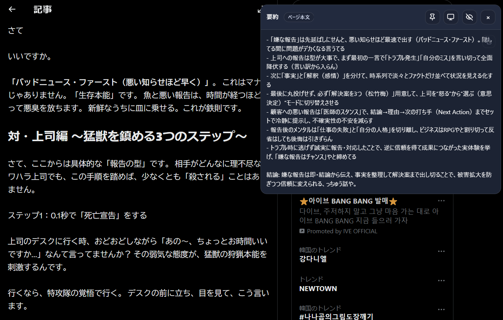
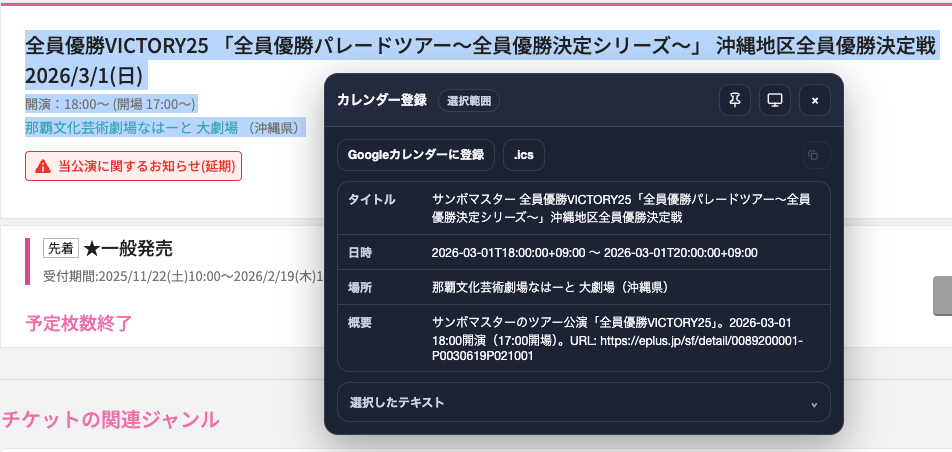
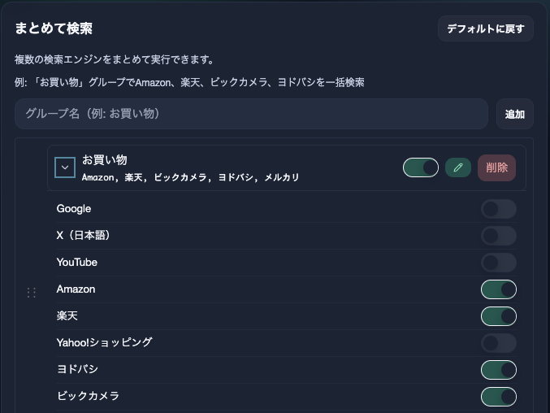

# Browser Toolkit

個人用の Chrome 拡張機能（Manifest V3）です。テーブルソート、AI による要約・翻訳・コードレビュー、リンク作成、検索エンジン連携など、日々のブラウザ作業でよく使う機能をまとめています。

主な機能:

- テーブルソート & フォーカス維持（動的テーブルへの自動適用、行フィルタリング、非アクティブタブのフォーカス維持）
- AI（OpenAI / ChatGPT プラン / Anthropic / z.ai）を使った Context Actions（要約・翻訳・コードレビュー・カスタムアクション）
- Gemini で要約（選択テキストやリンク先・YouTube 動画を Gemini へ自動入力して調査・要約）
- カレンダー登録（ページ内容からイベント情報を抽出し、Google カレンダーや `.ics` へ出力）
- リンク作成（タブのタイトルと URL を 7 形式でコピー）と QR コード生成
- 検索エンジン（選択テキストを任意の検索先で検索）とまとめて検索（グループ単位の一括検索）
- テキストテンプレート（定型文を右クリックメニューから貼り付け）
- アクション履歴（直近 20 件の AI 実行結果を参照）
- 検索結果ブロックリスト（Google の検索結果から指定サイトを非表示）
- X の画像ズーム（`x.com` / `twitter.com` の写真表示で全画面ズームと元画像保存）

## スクリーンショット

### Context Actions（要約）



記事やページ本文を選択して「要約」を実行すると、AI が内容を要約してオーバーレイ表示します。結果はコピーしたり、画面右上に固定したりできます。

### カレンダー登録



イベントページで実行すると、タイトル・日時・場所・概要を抽出し、Google カレンダーの登録リンクや `.ics` ファイルとして出力します。

### 検索エンジン


選択したテキストを登録済みの検索エンジンで検索できます。URL テンプレートに `{query}` を含めることで、任意の検索先を追加できます。

### まとめて検索



複数の検索エンジンをグループ化し、一度にまとめて検索できます。たとえば既定の「日用品系」グループを使えば、Amazon・楽天・価格.com・ヨドバシ・ビックカメラを一括で検索できます。

## 機能一覧

### テーブルソート & フォーカス維持

- テーブルソート:
  - `<th>` ヘッダーのクリックで昇順・降順を切り替え（数値と文字列を自動判定）
  - ポップアップの「サイト別機能」タブから現在のタブで手動有効化、または URL パターン（`*` ワイルドカード対応、プロトコルは無視）による自動有効化を設定
  - `MutationObserver` で後から動的に挿入されたテーブルも自動検出
  - 行フィルタリング: 0円・ハイフン・空白・N/A の行を非表示（パターンごとに ON/OFF を切り替え）
- フォーカス維持:
  - URL パターンに一致するサイトで、タブが非アクティブでも表示中として扱わせる機能
  - ポップアップの「サイト別機能」タブからパターン管理と現在のタブの診断を実行可能

### Context Actions（AI 連携）

- 対応プロバイダー:
  - OpenAI（`gpt-6-luna` / `gpt-6.1-sol`）
  - ChatGPT プラン（Sign in with ChatGPT、Plus / Pro の利用枠を使用・API キー不要）
  - Anthropic（`claude-opus-5` / `claude-sonnet-5` / `claude-haiku-4-5`）
  - z.ai（`glm-5` / `glm-4.7` / `glm-4.6` / `glm-4.5`）
- 実行方法:
  - ポップアップ → **アクション** タブ
  - 右クリック → **Browser Toolkit** → アクション名
- 組み込みアクション:
  - 要約
  - 日本語に翻訳
  - コードレビュー
- カスタムアクション:
  - ポップアップの **アクション** タブ（またはオプションページ）から作成・編集・削除・リセットが可能
  - 種別: `text`（通常テキスト）/ `event`（カレンダー連携向け構造化イベント）
  - テンプレート変数: `{{text}}` / `{{title}}` / `{{url}}` / `{{source}}`
  - ドラッグ&ドロップで並び替え可能（右クリックメニューの順序にも反映）
- 結果表示:
  - ポップアップ内の出力パネル（コピー機能付き）
  - 右クリック実行時はページ上にオーバーレイ表示（コピー・ピン留め・ドラッグ移動・フォローアップ質問に対応）

詳細は [docs/context-actions.md](docs/context-actions.md) を参照してください。

### Gemini で要約

- 右クリック → **Browser Toolkit** → **Geminiで要約** から実行
- テキストを選択している場合は Web 調査用プロンプト、選択なしでページやリンクの上から実行した場合はリンク先（YouTube 動画を含む）の要約用プロンプトを生成します。新しいタブで Gemini（`gemini.google.com`）を開き、プロンプトを自動入力して送信します
- 自動入力に失敗した場合はプロンプトをクリップボードへコピーします

### カレンダー登録

- ページの本文や選択テキストから、イベントのタイトル・日時・場所・概要を AI が抽出
- 抽出結果を Google カレンダーの登録リンク、または `.ics`（iCal）ファイルとして出力
- ポップアップ → **カレンダー** タブ、または右クリック → **Browser Toolkit** → **カレンダー登録** から実行

### リンク作成・QR コード生成

- 現在のタブのタイトルと URL を編集・プレビューし、7 形式でクリップボードにコピー
  - URL
  - テキスト（タイトル + 改行 + URL）
  - Markdown: `[タイトル](<URL>)`
  - GitHub（#番号 + タイトル）: PR / Issue ページを `[#123 タイトル](<URL>)` 形式で出力
  - HTML: `<a href="URL">タイトル</a>`
  - Org-mode: `[[URL][タイトル]]`
  - BBCode: `[url=URL]タイトル[/url]`
- 右クリック → **Browser Toolkit** → **タイトルとリンクをコピー** から主要 5 形式（URL / テキスト / Markdown / GitHub / HTML）を直接コピー可能
- QR コード生成:
  - 右クリック → **Browser Toolkit** → **QRコードを表示** で現在のページ URL をページ上にオーバーレイ表示
  - ポップアップの **リンク作成** タブ内でもプレビュー表示可能

### 検索エンジン・まとめて検索

- 選択テキストを任意の検索エンジンで検索（右クリック → **Browser Toolkit** → **検索** → エンジン名）
- 既定の登録先（19 件）:
  - 汎用・技術・SNS: Google、DuckDuckGo、Yandex、GitHub、Google マップ、X（日本語）、X（完全一致・日本語）、YouTube
  - ショッピング・価格比較: Amazon、楽天、Yahoo!ショッピング、価格.com、ヨドバシ、ビックカメラ、サウンドハウス
  - フリマ・オークション: メルカリ、ヤフオク、ラクマ、PayPayフリマ
- カスタム検索エンジンを最大 20 件まで登録可能。URL テンプレートには `{query}` が必須で、必要に応じて `{url}`、`{title}`、Shift_JIS エンコーディングにも対応します
- まとめて検索（右クリック → **Browser Toolkit** → **まとめて検索** → グループ名）:
  - 既定グループ: **日用品系**、**徹底比較**、**トレンド**
  - 最大 10 グループまで作成・編集・並び替え可能
- 検索エンジンとまとめて検索の編集・並び替えはオプションページから行えます

### テキストテンプレート

- よく使う定型文を右クリック → **Browser Toolkit** → **テンプレートを貼り付け** → テンプレート名 から入力欄へ挿入
- 既定のテンプレート（コードレビュー用）: `greptileai review`、`greptileai improve`、`greptileai accept`、`coderabbitai review`、`LGTM`
- オプションページ → **テンプレート** タブから追加・編集・削除・非表示設定・ドラッグ&ドロップでの並び替えが可能

### 検索結果ブロックリスト

- Google の検索結果から指定したサイトを非表示にできます（v1 は Google 検索のみ対応）
- 使い方: 検索結果カードにカーソルを合わせると表示される遮断アイコンからダイアログを開き、ルールを追加します
- ルール構文: match pattern のサブセット（`*://*.example.com/*`、`example.com`、`*://example.com/path/*`）に対応しています。**正規表現は v1 未対応**のため、入力するとエラーになります
- 保存先は `chrome.storage.local` のため、**デバイス間では同期されません**
- 解除・管理: ページ上の件数バーから非表示結果の一時表示を切り替えられます。ルールの解除・編集や読めないルールの一括削除は、検索結果カードのダイアログまたはポップアップ → **検索ブロック** タブから行えます

### X の画像ズーム

- `x.com` / `twitter.com` の写真表示（`/status/<id>/photo/<n>`）で画像をクリックすると、Shadow DOM の全画面ビューアが開きます
- ズーム表示のほか、元画像（`https://pbs.twimg.com/media/` のみ許可）のダウンロードに対応しています

## インストール（パッケージ化されていない拡張機能）

1. 依存関係をインストールし、ビルドを実行します。
   - `pnpm install`
   - `pnpm run build`（`dist/` が生成されます）
2. Chrome で `chrome://extensions/` を開きます。
3. 右上の「デベロッパーモード」を有効にします。
4. 「パッケージ化されていない拡張機能を読み込む」をクリックし、`manifest.json` がある `browser-toolkit/` のルートディレクトリを選択します（`dist/` ではなくリポジトリ直下を選んでください）。

## 使い方

### テーブルソート・フォーカス維持

ポップアップ → **サイト別機能** タブから操作します。

- このタブで有効化: 現在のタブでテーブルソートを即座に有効にします
- 自動ソート対象サイト: 自動有効化したいサイトの URL パターンを登録します（例: `*.moneyforward.com/bs/*`、`example.com/path*`）
- フォーカス維持: タブが非アクティブでも表示中扱いにしたいサイトの URL パターンを登録し、現在のタブへの反映状況を診断できます

### Context Actions

- ポップアップ（**アクション** タブ）から実行: 選択範囲 → 直近の選択キャッシュ（同一オリジン・有効期限の目安は約 30 秒）→ ページ本文、の順に対象テキストを決めます
- 右クリックから実行: 右クリックメニュー → **Browser Toolkit** → アクション名 を選びます

## 設定と画面構成

ポップアップは画面サイズが限られるため日常的によく使う 5 機能に絞り、管理系の画面は拡張機能の **オプションページ**（`options.html`）に分離しています。ポップアップのサイドバー下部にある「設定」を押すか、`chrome://extensions/` の「拡張機能のオプション」から開けます。オプションページでは日常操作の 5 機能に管理系の 5 機能を加えた全 10 タブをフル画面で扱えます。

### ポップアップのタブ

- アクション: Context Actions の実行・結果表示・編集・並び替え
- カレンダー: ページからイベント情報を抽出し、Google カレンダー / `.ics` へ出力
- リンク作成: タイトルと URL のコピー・QR コード表示
- 検索ブロック: 検索結果ブロックリストのルール編集
- サイト別機能: テーブルソートとフォーカス維持の URL パターン管理

### オプションページで追加される管理タブ

- 検索エンジン: 検索エンジン一覧の編集・並び替え
- まとめて検索: 検索エンジングループの編集・並び替え
- テンプレート: テキストテンプレートの編集・並び替え
- 履歴: 直近 20 件のアクション実行結果の確認
- 設定: AI プロバイダー・モデル・テーマ・デバッグログの管理

### 設定画面の主な項目

- AI プロバイダー: OpenAI / ChatGPT プラン / Anthropic / z.ai を切り替え
- API トークン: 選択中のプロバイダーのトークンを保存（`chrome.storage.local` に保存されるため同期されません）
- ChatGPT プラン: 「ChatGPT で続行」を押すとブラウザのタブにサインイン画面が開き、完了後に通知が表示されます。利用状況と上限は [ChatGPT の設定](https://chatgpt.com/settings/usage) で確認できます。モデルは OpenAI と同じ選択肢を使います
- モデル: プロバイダーごとの対応モデルから選択
  - OpenAI / ChatGPT プラン: `gpt-6-luna`（既定）/ `gpt-6.1-sol`
  - Anthropic: `claude-sonnet-5`（既定）/ `claude-opus-5` / `claude-haiku-4-5`
  - z.ai: `glm-4.7`（既定）/ `glm-5` / `glm-4.6` / `glm-4.5`
- 追加指示: 任意で指定でき、出力の口調や形式の好みを上乗せできます
- テーマ: 自動 / ライト / ダーク（ポップアップとページ内 UI の両方に反映されます）

## 開発

### 必要要件

- Node 24 以上（`mise.toml` では Node 26 系を固定）
- pnpm（バージョンは `package.json` の `packageManager` に従います）
- `mise`（任意・推奨）: Node や lint 関連ツールのバージョンを揃えるために使います

### セットアップ

1. `mise` を使う場合は、`mise trust` を実行してリポジトリを信頼させます。
2. `pnpm install` で依存関係をインストールします。
3. ローカル検証時は、目的に応じて以下のいずれかを起動します。
   - `pnpm run dev`（開発サーバー: 自動ビルド + 拡張機能の自動リロード）
   - `pnpm run watch`（自動ビルドのみ、リロードは手動）
   - `pnpm run storybook`（UI をブラウザで確認）
4. 準備ができたら `pnpm run build` を実行し、`manifest.json` のあるリポジトリ直下（`browser-toolkit/`）を Chrome に読み込みます。

### コマンド

基本の作業には `mise` タスクを使います。

- `mise run format`: Ultracite（Biome）による自動整形 + `mise.toml` の Taplo 整形
- `mise run lint`: 型チェックと Biome Lint
- `mise run test`: Vitest ユニットテスト（Node + DOM）
- `mise run test:storybook`: Storybook / Vitest addon のテスト
- `mise run build`: `dist/` へのバンドル出力
- `mise run check`: `lint` + `test` + `test:storybook`
- `mise run ci`: `format` / `lint:actions` / `actions-lock:verify` / `lint` / `test` / `test:storybook` / `build` をまとめて実行
- `mise run report:knip`: Knip による未使用ファイル・export・依存のレポート（トリアージ方針は [docs/knip.md](docs/knip.md)）
- `mise run report:jev`: `jev-lint` で `origin/main` との差分を LLM レビューします。実行前に `git fetch origin main` と `TYPESAFE_API_KEY` が必要です（CI 非組み込み）

その他の `pnpm` スクリプト:

- `pnpm run dev`: 開発サーバー（自動ビルド + 拡張機能の自動リロード）
- `pnpm run watch`: バンドルの監視ビルド
- `pnpm run storybook`: Storybook の起動（`http://localhost:6006`）
- `pnpm run test:unit:node`: Node 環境のユニットテスト
- `pnpm run test:unit:dom`: jsdom 環境のユニットテスト
- `pnpm run test:e2e`: Playwright E2E テストの実行
- `pnpm run test:e2e:ui`: E2E テストを UI モードで実行
- `pnpm run test:e2e:debug`: E2E テストをデバッグモードで実行
- `pnpm run test:visual`: Visual Regression Testing の実行
- `pnpm run test:visual:update`: Visual スナップショットの更新
- `pnpm run package:cws`: Chrome Web Store 提出用 zip（`tmp/browser-toolkit-<version>.zip`）を生成
- `pnpm run publish:cws`: Chrome Web Store API v2 へアップロード・審査提出（`--dry-run` / `--skip-publish` 対応）

### 開発モード（自動リロード）

`pnpm run dev` を使うと、ソースコードの変更に合わせて拡張機能が自動でリロードされます。

1. 通常どおり拡張機能を Chrome に読み込みます。
2. ターミナルで `pnpm run dev` を実行します。
3. ソースコードを編集して保存すると、自動でビルドされ拡張機能がリロードされます。

仕組みと注意点:

- WebSocket サーバー（`ws://localhost:8090`）がファイル変更を検知し、開発ビルドの background script が通知を受けて `chrome.runtime.reload()` を呼び出します。
- 本番ビルド（`pnpm run build`）には自動リロード用のコードを含めません。
- コンテンツスクリプトを変更した場合は、拡張機能のリロードに加えて対象ページの再読み込みも必要です。

### E2E テスト

Playwright を使った E2E テストで、拡張機能の動作を実ブラウザで検証できます。

```bash
# 拡張機能をビルド（初回や変更後）
pnpm run build

# E2E テストを実行
pnpm run test:e2e

# UI モード / デバッグモードで実行
pnpm run test:e2e:ui
pnpm run test:e2e:debug
```

注意点:

- `headless: false` で動作するため、実行時に Chrome ウィンドウが開きます（CI には組み込んでいません）。
- テスト実行中、拡張機能は自動で読み込まれます。テスト用の fixture は `tests/e2e/fixtures/` に配置しています。
- 手動 E2E テストのチェック項目は [docs/e2e-test-checklist.md](docs/e2e-test-checklist.md) にまとめています。

### Visual Regression Testing

Storybook Test Runner と Playwright のスナップショットを組み合わせ、UI の視覚的な変化を検出します。

```bash
# 別ターミナルで Storybook を起動
pnpm run storybook

# Visual Regression Testing を実行
pnpm run test:visual

# 意図的な UI 変更後にスナップショットを更新
pnpm run test:visual:update
```

注意点:

- すべての Story でライト・ダーク両テーマのスナップショットを取得します（許容誤差 1%）。
- スナップショットは `__snapshots__/` に保存され、`.gitignore` により Git には追跡されません。
- 初回実行時はすべてのスナップショットが新規作成されます。意図的に UI を変更した後は `pnpm run test:visual:update` で基準を更新してください。

## プロジェクト構成

```
browser-toolkit/
├── dist/                      # バンドル出力（生成物）
├── docs/                      # ドキュメント
│   ├── architecture.md        # アーキテクチャ設計
│   ├── context-actions.md     # Context Actions ガイド
│   ├── e2e-test-checklist.md  # 手動 E2E テストチェックリスト
│   ├── icon-setup.md          # アイコン作成・更新手順
│   ├── knip.md                # Knip のエントリ設定と分類記録
│   ├── privacy-policy.html    # プライバシーポリシー
│   └── style-management.md    # Design Tokens / テーマ管理
├── manifest.json              # 拡張機能マニフェスト（MV3）
├── popup.html                 # ポップアップのエントリ（popup_bootstrap.js 経由で dist/popup.js を読み込み）
├── options.html               # オプションページのエントリ（options_bootstrap.js 経由で dist/options.js を読み込み）
├── scripts/                   # ビルド・開発サーバー・Chrome Web Store 提出スクリプト
├── src/
│   ├── background.ts          # Service Worker エントリ
│   ├── content.ts             # コンテンツスクリプトエントリ（全ページ）
│   ├── search-blocklist.ts    # コンテンツスクリプトエントリ（Google 検索、document_start）
│   ├── image-zoom.ts          # コンテンツスクリプトエントリ（X の画像ズーム）
│   ├── focus-override.ts      # フォーカス維持スクリプトエントリ
│   ├── popup.ts               # ポップアップ（React root）
│   ├── options.ts             # オプションページ（React root）
│   ├── ai/                    # AI アダプター（OpenAI / ChatGPT プラン / Anthropic / z.ai）と共通設定
│   ├── background/            # Service Worker モジュール（contextMenus / runtime / storage / AI 実行）
│   ├── components/            # 共有 React コンポーネント
│   ├── constants/             # API エンドポイント・モデル一覧・タイムアウト定数
│   ├── content/               # コンテンツスクリプトモジュール（overlay / table-sort / template-paste / search-blocklist-ui）
│   ├── focus-override/        # フォーカス維持の実装とパターン管理
│   ├── i18n/                  # 表示文言（resources.ts）と軽量ローダー（lite.ts）
│   ├── image-zoom/            # X 画像ズームビューアとダウンロード URL 検証
│   ├── popup/                 # ポップアップ／オプションページ UI（pane ベース、React + Base UI）
│   ├── prompts/               # 組み込みアクションプロンプト（TOML）
│   ├── schemas/               # Valibot スキーマ（プロバイダー・設定・認証等）
│   ├── search-blocklist/      # 検索結果ブロックリストのルール解析・マッチング・エンジンアダプター
│   ├── storage/               # ストレージ型定義とマイグレーション
│   ├── styles/                # Design Tokens・基本スタイル
│   ├── types/                 # グローバル型定義
│   ├── ui/                    # 共通 UI（theme / styles / modal-controller / toast）
│   └── utils/                 # ユーティリティ
└── tests/                     # Vitest（Node / jsdom + chrome stub）+ Playwright E2E
```

詳しいアーキテクチャは [docs/architecture.md](docs/architecture.md) を参照してください。

## プライバシーとセキュリティ

利用者のプライバシー方針の詳細は [docs/privacy-policy.html](docs/privacy-policy.html) にまとめています。

- 開発者側のサーバーへのデータ収集や、アナリティクス・広告トラッキングは行いません。
- AI プロバイダーごとの API トークン、ChatGPT プランの OAuth トークン（access / refresh / ID token）および端末ごとの host ID は `chrome.storage.local` に保存します（同期しません）。サインアウト時は OpenAI 側で refresh token を失効させてから削除します。
- URL パターン、アクション定義、検索エンジン、テンプレートなどの非機密設定は `chrome.storage.sync` に保存します。
- 選択テキストはポップアップ実行時の動作を安定させるため、`chrome.storage.local` に短時間キャッシュすることがあります（有効期限の目安は約 30 秒、同一オリジンのページでのみ参照）。
- 外部サービス（AI プロバイダー、Gemini、Google カレンダー）へのデータ送信は、**利用者が明示的に機能を実行したときだけ**発生します。
- Context Actions の送信対象テキストは、ポップアップからの実行では **選択範囲 → 直近の選択キャッシュ → ページ本文**、右クリックからの実行では **右クリック時の選択範囲 → ページ本文** の優先順で決まります。

## ライセンス

ISC
